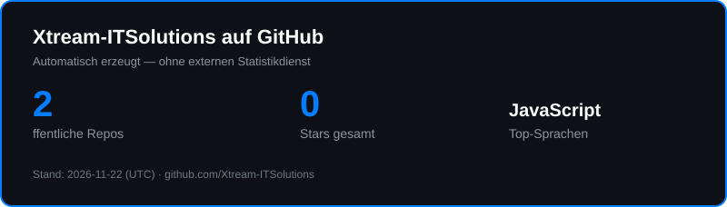

Das Logo wird über unser CDN ausgeliefert: <a target="_blank" rel="noopener noreferrer" href="https://cdn.xtream-itsolutions.com/r/UWOU7I">cdn.xtream-itsolutions.com/r/UWOU7I</a>

# Xtream-ITSolutions

### Managed Infrastructure · Cloud · Software Engineering

**Infrastruktur für Unternehmen — klar betrieben, sauber skaliert.**

Wir unterstützen Unternehmen, Start-ups und Entwickler beim Aufbau und Betrieb moderner, sicherer IT-Lösungen – von der Infrastruktur bis zur individuellen Software. Alles aus einer Hand, mit festen Ansprechpartnern in Deutschland.

 

  

---

## Inhaltsübersicht

> GitHub-READMEs erlauben kein JavaScript und kein eigenes CSS — echte Tabs mit umschaltbaren Inhalten sind daher technisch nicht möglich. Als Ersatz gibt es hier eine Tab-Navigation aus anklickbaren Badges, die direkt zum jeweiligen Abschnitt springt.

<strong>Alle Abschnitte im Überblick</strong>

- [Was wir machen](#was-wir-machen)
- [Warum Xtream-ITSolutions](#warum-xtream-itsolutions)
- [Kennzahlen](#kennzahlen)
- [Leistungsbereiche](#leistungsbereiche)
- [Technische Schwerpunkte](#technische-schwerpunkte)
- [Für wen wir arbeiten](#für-wen-wir-arbeiten)
- [Technologien](#technologien)
- [Wie wir arbeiten](#wie-wir-arbeiten)
- [Beispielhafte Anwendungsfälle](#beispielhafte-anwendungsfälle)
- [Öffentliche Repositories](#öffentliche-repositories)
- [Aktuelle Schwerpunkte](#aktuelle-schwerpunkte)
- [Open Source & Mitarbeit](#open-source--mitarbeit)
- [Beitragsaktivität](#beitragsaktivität)
- [Häufige Fragen](#häufige-fragen)
- [Kontakt](#kontakt)
- [English summary](#english-summary)

## Was wir machen

Xtream-ITSolutions UG (haftungsbeschränkt) entwickelt und betreibt digitale Lösungen für Kunden, die **zuverlässige Infrastruktur und technische Umsetzung aus einer Hand** suchen. Unser Schwerpunkt liegt auf nachvollziehbarem Betrieb, klarer Kommunikation und Lösungen, die langfristig wartbar bleiben.

Wir verbinden **Softwareentwicklung, Infrastruktur und Betrieb**. Dadurch werden technische Entscheidungen nicht nur implementiert, sondern auch unter realen Betriebsbedingungen bewertet und weiterentwickelt — inklusive Monitoring, Backups und dokumentierter Betriebsabläufe.

## Warum Xtream-ITSolutions

| Prinzip | Was das für dich bedeutet |
|---|---|
| **🛠️ Alles aus einer Hand** | Hosting, Cloud, Entwicklung und Betreuung mit klarer Zuständigkeit statt vieler Dienstleister. |
| **📖 Wartbar statt schnell zusammengebaut** | Saubere Architektur, Dokumentation und reproduzierbare Deployments — auch in einem Jahr noch verständlich. |
| **🧑‍💻 Direkter Draht** | Feste Ansprechpartner, E-Mail mit Verlauf, Telefon für Eiliges und Discord für den laufenden Austausch. |
| **🇩🇪 Betrieb in Deutschland** | Systeme in Frankfurt am Main, Verarbeitung nach DSGVO mit AV-Vertrag, Vertragspartner in Deutschland. |

## Kennzahlen

Die Grafik wird täglich per GitHub Action aus unseren öffentlichen Repositories erzeugt und liegt als eigene Datei im `output`-Branch — ganz ohne externen Statistikdienst.

Stand der Unternehmenskennzahlen: siehe [Über uns](https://xtream-itsolutions.com/unternehmen/ueberuns) und jeweilige Produktseite — konkrete Verfügbarkeiten und Reaktionszeiten gelten je vereinbartem Leistungsumfang beziehungsweise SLA.

| Kennzahl | Wert |
|---|---|
| **👥 Kunden** | 500+ |
| **📡 Verfügbarkeit** | 99,9 % (Zielwert Plattform) |
| **⚡ Erstreaktion** | < 15 Min. |
| **🕓 Betrieb** | 24/7 möglich (je nach Paket) |
| **📍 Rechenzentrum** | Frankfurt am Main, DE-CIX-Anbindung |

> Hinweis: Wir nutzen bewusst nur Shields.io-Badges, native GitHub-Workflow-Badges und eigene per Action erzeugte Grafiken (Snake). Externe Statistik-Kartendienste (z. B. github-readme-stats) lassen wir weg, damit das Profil auch bei Rate-Limits und Ausfällen fremder Bilddienste vollständig lesbar bleibt.

## Leistungsbereiche

| Bereich | Typische Aufgaben | Ergebnis |
|---|---|---|
| **☁️ Managed Hosting** | Webhosting, VPS, dedizierte Server, Domains und SSL | Stabiler und nachvollziehbarer Betrieb |
| **💻 Software Engineering** | Web-Apps, APIs, Automationen, Bots und Integrationen | Wartbare, dokumentierte Software |
| **🔒 Security & DevOps** | Docker, CI/CD, Monitoring, Backups und Hardening | Reproduzierbare Deployments und geringere Betriebsrisiken |
| **🧭 IT-Consulting** | Architektur, Migration, Digitalisierung und technische Projektbegleitung | Klare Entscheidungen und umsetzbare Roadmaps |

Mehr dazu unter [Produkte & Leistungen](https://xtream-itsolutions.com/produkte) und in unserem [Rechenzentrum in Frankfurt](https://xtream-itsolutions.com/unternehmen/rechenzentrum).

## Technische Schwerpunkte

### Plattformen und Webanwendungen

- Moderne Webanwendungen mit React, Next.js, Vue und TypeScript
- Backend- und API-Entwicklung mit Node.js, PHP/Laravel und Python
- Authentifizierung, Rollenmodelle, Integrationen und automatisierte Abläufe
- Responsive Oberflächen mit Fokus auf verständliche Nutzerführung

### Infrastruktur und Betrieb

- Containerisierte Anwendungen mit Docker und Kubernetes
- Linux-basierter Betrieb, DNS, TLS, Reverse Proxies und Netzwerkkonzepte
- CI/CD-Pipelines für reproduzierbare Builds und Deployments
- Monitoring, Backups, Logging und dokumentierte Betriebsabläufe

### Sicherheit und Qualität

- Prinzipien der minimalen Berechtigung und getrennte Umgebungen
- Secret- und Konfigurationsmanagement ohne Zugangsdaten im Repository
- Abhängigkeiten, Updates und externe Schnittstellen im Blick behalten
- Technische Entscheidungen nachvollziehbar dokumentieren

> Verfügbarkeiten, Reaktionszeiten und Supportumfang richten sich nach dem jeweils vereinbarten Leistungsumfang beziehungsweise SLA.

## Für wen wir arbeiten

Unsere Leistungen richten sich insbesondere an **kleine und mittlere Unternehmen, Start-ups, Agenturen, Entwicklerteams und Betreiber digitaler Plattformen**. Wir übernehmen sowohl klar abgegrenzte Entwicklungsaufgaben als auch die technische Betreuung laufender Systeme — vom kleinen Einstieg bis zum laufenden Betrieb.

## Technologien

### Frontend & Design

### Backend & Daten

### Infrastruktur & Betrieb

## Wie wir arbeiten

| Phase | Inhalt |
|:---:|---|
| **1. 🔍 Verstehen** | Ziele, bestehende Systeme, Risiken und Prioritäten gemeinsam klären |
| **2. 🗺️ Planen** | Technische Optionen vergleichen und einen realistischen Umfang festlegen |
| **3. 🔧 Umsetzen** | In nachvollziehbaren Schritten entwickeln, testen und dokumentieren |
| **4. 📈 Betreiben** | Übergabe, Monitoring, Wartung und Weiterentwicklung passend zum Bedarf |

Wir starten gerne mit einem **kleinen, klar abgegrenzten ersten Schritt**. So werden technische Annahmen früh geprüft, bevor größere Investitionen entstehen.

## Beispielhafte Anwendungsfälle

Ein Teil unserer Arbeit entsteht als interne oder kundenspezifische Software und ist deshalb nicht öffentlich einsehbar. Typische Vorhaben aus der Praxis:

- **Webplattform für KMU** — moderne Website oder Kundenportal mit CMS-Anbindung, Hosting, SSL und Backups aus einer Hand.
- **API & Automatisierung** — Schnittstellen, Bots und Workflows, die manuelle Prozesse ersetzen und Fehlerquellen reduzieren.
- **Migration in betreutes Hosting** — Umzug bestehender Systeme nach Deutschland, inklusive DNS, TLS, Monitoring und Dokumentation.
- **Absicherung laufender Systeme** — Hardening, Updates, Backup- und Monitoring-Konzept für weniger Betriebsrisiko.

Für passende Anfragen zeigen wir gerne relevante Arbeitsproben, technische Konzepte oder eine individuelle Demo. Dabei klären wir vorab, welche Informationen vertraulich bleiben müssen.

## Aktuelle Schwerpunkte

- 🔧 Ausbau und Dokumentation moderner Container- und Kubernetes-Infrastrukturen
- 🚀 Weiterentwicklung von Webplattformen und TypeScript-Anwendungen
- 🤖 Automatisierte Deployments, Monitoring und sichere Betriebsprozesse
- ✨ Praktische KI-Integrationen für Support und interne Abläufe
- 🔌 Self-Service- und API-Funktionen für Kunden und Entwickler

## Open Source & Mitarbeit

Öffentliche Repositorys bilden nur einen Ausschnitt unserer technischen Arbeit ab — viele Plattformen, Automationen und Infrastrukturwerkzeuge entstehen intern oder kundenspezifisch.

- Fehler gefunden? Eröffne gerne ein **Issue** im jeweiligen Repository.
- Du möchtest etwas beitragen? Lies vorher kurz [CONTRIBUTING.md](CONTRIBUTING.md).
- Sicherheitslücke vermutet? Bitte **nicht** öffentlich melden, sondern vertraulich per E-Mail gemäß [SECURITY.md](SECURITY.md).

## Öffentliche Repositories

| Repository | Hauptsprache | Stars |
|---|---|---|
| <a target="_blank" rel="noopener noreferrer" href="https://github.com/Xtream-ITSolutions/xitphoneboard">xitphoneboard</a> | JavaScript | 0 |
| <a target="_blank" rel="noopener noreferrer" href="https://github.com/Xtream-ITSolutions/xtream-itsolutions">xtream-itsolutions</a> | – | 0 |

`xtream-itsolutions` enthält diese Profilseite. Viele Kunden- und Infrastrukturprojekte bleiben aus Sicherheits- und Vertraulichkeitsgründen privat — die Tabelle zeigt den aktuellen öffentlichen Stand.

## Beitragsaktivität

<picture>
  <source media="(prefers-color-scheme: dark)" srcset="https://raw.githubusercontent.com/Xtream-ITSolutions/xtream-itsolutions/output/github-contribution-grid-snake-dark.svg" />
  <source media="(prefers-color-scheme: light)" srcset="https://raw.githubusercontent.com/Xtream-ITSolutions/xtream-itsolutions/output/github-contribution-grid-snake.svg" />
  
</picture>

Die Animation wird täglich per GitHub Action aus deinen Beiträgen neu erzeugt und liegt als eigene Grafik im `output`-Branch — ganz ohne externen Bilddienst. Unsere aktuelle Arbeit, Repositories und technischen Änderungen findest du direkt auf GitHub.

## Häufige Fragen

<strong>Übernehmt ihr auch kleine Projekte oder einzelne Aufgaben?</strong>

Ja. Wir starten gerne mit einem klar abgegrenzten ersten Schritt — zum Beispiel Hosting-Umzug, einzelne API-Anbindung oder technische Bestandsaufnahme — und erweitern danach bei Bedarf.

<strong>Betreut ihr auch laufende Systeme?</strong>

Ja. Neben Entwicklung übernehmen wir Monitoring, Updates, Backups und Weiterentwicklung passend zum vereinbarten Leistungsumfang beziehungsweise SLA.

<strong>Wo werden Daten gehostet?</strong>

Standardstandort ist Frankfurt am Main in Deutschland. Verarbeitung nach DSGVO mit Auftragsverarbeitungsvertrag, kein Drittlandstransfer durch den Betrieb. Details stehen auf der Seite [Rechenzentrum](https://xtream-itsolutions.com/unternehmen/rechenzentrum).

<strong>Warum ist hier nicht alles öffentlich auf GitHub?</strong>

Viele Kunden- und Infrastrukturprojekte dürfen aus Sicherheits- und Vertraulichkeitsgründen nicht öffentlich sein. Öffentliche Repositorys zeigen daher nur einen Ausschnitt. Relevante Arbeitsproben und Demos teilen wir auf Anfrage.

## Kontakt

Du planst ein IT-, Hosting- oder Softwareprojekt? Schick uns am besten:

- eine kurze Beschreibung des Vorhabens oder Problems,
- den gewünschten Zeitrahmen,
- vorhandene Systeme oder technische Rahmenbedingungen,
- und – falls bekannt – das gewünschte Ergebnis.

Wir klären gemeinsam Anforderungen, technische Optionen und den passenden nächsten Schritt.

- 📧 **E-Mail:** [support@xtream-itsolutions.com](mailto:support@xtream-itsolutions.com)
- 📞 **Telefon:** [+49 2366 5830630](tel:+4923665830630) (für die schnelle erste Abstimmung)
- 💬 **Discord:** [Server beitreten](https://discord.gg/xtream-itsolutions)
- 📝 **Formular:** [Kontaktseite mit Termin- und Routenplanung](https://xtream-itsolutions.com/unternehmen/kontakt)

## English summary

Xtream-ITSolutions UG builds and operates modern, secure IT solutions — from managed infrastructure to custom software. We combine **software engineering, infrastructure and operations** with a focus on maintainability, clear communication and documented operations. Our default hosting region is **Frankfurt, Germany (GDPR-compliant)**. Working languages are **German and English**. The best way to start is a small, well-scoped first step: [contact us](https://xtream-itsolutions.com/unternehmen/kontakt).

<a target="_blank" rel="noopener noreferrer" href="https://xtream-itsolutions.com/unternehmen/ueberuns">Über uns</a> ·
<a target="_blank" rel="noopener noreferrer" href="https://xtream-itsolutions.com/produkte">Produkte</a> ·
<a target="_blank" rel="noopener noreferrer" href="https://xtream-itsolutions.com/unternehmen/rechenzentrum">Rechenzentrum</a> ·
<a target="_blank" rel="noopener noreferrer" href="https://xtream-itsolutions.com/unternehmen/kontakt">Kontakt</a> ·
<a target="_blank" rel="noopener noreferrer" href="https://xtream-itsolutions.com/rechtliches/impressum">Impressum</a> ·
<a target="_blank" rel="noopener noreferrer" href="https://xtream-itsolutions.com/rechtliches/datenschutz">Datenschutz</a> ·
<a target="_blank" rel="noopener noreferrer" href="https://xtream-itsolutions.com/rechtliches/agb">AGB</a>

 

© 2024–2026 Xtream-ITSolutions UG (haftungsbeschränkt) · Deutschland

